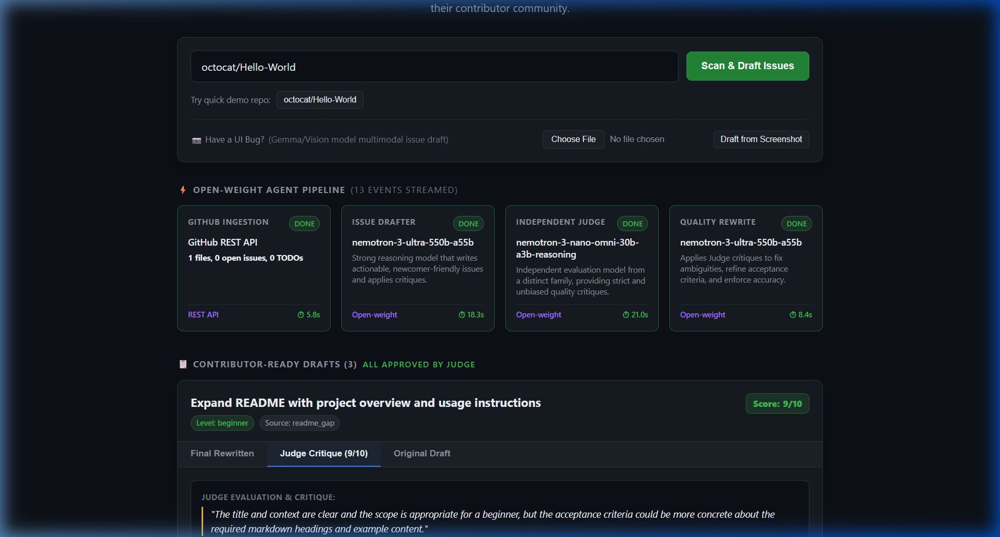
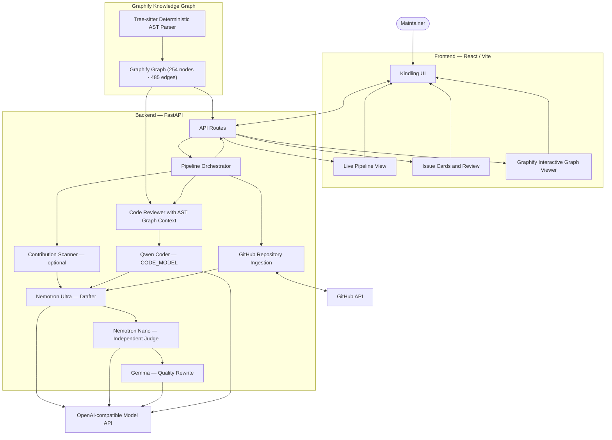

# 🔥 Kindling

[](LICENSE)
[](https://python.org)
[](https://fastapi.tiangolo.com)
[](https://vitejs.dev)
[](https://github.com/Graphify-Labs/graphify)

**Kindling helps open-source maintainers attract and onboard contributors using a specialized crew of open-weight models.** 

One model reads your repository and TODOs to draft actionable issues; an independent model evaluates them for clarity, newcomer accessibility, and scope creep; a third model rewrites them based on the critique; and an AST code analysis model inspects real source files with structural call-graph context. Maintainers watch every step stream in real time and approve each issue before anything posts to GitHub.

Built for the **GDGVU Hacktoberfest Hackathon** (Track: *Best Open-Source AI Project*).

---



---

## 🧠 The Open-Weight Model Crew

Kindling uses an OpenAI-compatible API layer (`AsyncOpenAI`) so every role is powered by open-weight models. By design, the **Judge** model differs from the **Drafter** model so a model never grades its own work.

| Role | Default Model | Why This Model | License |
| :--- | :--- | :--- | :--- |
| **Code Reviewer** | `qwen/qwen-2.5-coder-32b-instruct` | Deep source code analysis and line-level bug evidence extraction, augmented with Graphify AST call flows. | Apache 2.0 |
| **Drafter** | `nvidia/nemotron-3-ultra-550b-a55b` | High reasoning and code comprehension capacity for synthesizing repo trees, README gaps, and TODO context snippets into structured JSON issues without hallucinating identifiers. | NVIDIA Open Model License |
| **Judge (Critic)** | `nvidia/nemotron-3-nano-omni-30b-a3b-reasoning` *(or `meta/muse-glimmer-30b`)* | Fast, independent reasoning model dedicated to auditing drafts for clarity, hallucinated symbols, missing acceptance criteria, and scope creep. | NVIDIA Open Model License / Open-Weight |
| **Quality Rewrite** | `google/gemma-4-31b-it` | Dedicated Gemma model to apply Judge critiques, polish acceptance criteria, and refine issue testability. | Gemma Terms of Use |
| **Vision (Stretch)** | `meta/llama-3.2-11b-vision-instruct` | Multimodal open-weight model capable of turning UI bug screenshots into structured contributor issues. | Llama 3.2 Community License |
| **Graphify Engine** | `Tree-sitter AST Extractor` | Deterministic local codebase knowledge graph (254 nodes, 485 edges) mapping call flows, module dependencies, and God Nodes. | Open-Source Tool |

---

## 🕸️ Graphify Code Knowledge Graph

Kindling integrates **Graphify** (`graphifyy`) for deterministic structural AST parsing:
- **Zero Vector Overhead**: Directly extracts 254 nodes, 485 edges, and 14 communities across Python, JavaScript, JSX, Markdown, and configs using local Tree-sitter parsers without needing LLMs or vector databases.
- **Architectural Discovery**: Identifies critical "God Nodes" (e.g. `pipeline.py`, `main.py`, `Draft`, `process_drafts()`) and caller/callee dependencies.
- **Qwen Code Analysis Grounding**: Before analyzing source files, Graphify AST call hierarchies (e.g. `build_repo_summary() -> get_repo_summary()`) are injected directly into Qwen's prompt to provide topological relationship context.
- **Interactive Visualizer**: Built-in interactive browser visualization at [`/api/graphify/view`](http://localhost:8000/api/graphify/view) and high-resolution SVG diagram exports in `graphify-out/`.

---

## 🏗️ System Architecture

This diagram shows Kindling's repository-analysis and issue-generation flow:



---

## ✨ Key Features

- **Live Crew Pipeline UI:** Watch `GitHub Ingestion` $\rightarrow$ `Code Reviewer (Qwen)` $\rightarrow$ `Drafter` $\rightarrow$ `Judge` $\rightarrow$ `Rewrite` execute in real time via Server-Sent Events (SSE), complete with model badges, role justifications, licenses, and execution durations.
- **Anti-Hallucination Guardrails:**
  - Comment-constrained `find_todos` extracts real `#`, `//`, `/*`, and `*` comments (ignoring strings and regexes) along with 5 lines of surrounding code context.
  - Strict prompt rules forbid inventing function, class, or test names not present in inspected snippets.
  - Automatic path verification validates `files_to_touch` against the real GitHub repository tree while supporting newly proposed files via `new_files`.
- **Parallel Critique & Rewrite:** Per-draft Judge and Rewrite passes execute concurrently via `asyncio.gather` with capped token budgets (`max_tokens=1200`) for responsive turnaround.
- **Human-in-the-Loop Approval:** Maintainers inspect the **Original Draft**, **Judge Critique (with 1–10 score)**, and **Final Rewrite** side-by-side before clicking **Approve** to post directly to GitHub.
- **Deterministic Demo Replay (`DEMO_MODE=cached`):** Every completed run saves its event stream and payload to `data/cache/<owner>__<repo>.json`. Switching to `cached` mode replays the exact SSE pipeline with realistic pacing and zero live API latency for stage demos.

---

## 🚀 Quick Start (Windows PowerShell)

### 1. Clone & Set Up Python Environment
```powershell
git clone https://github.com/Abhiram-Mukkamala/Kindling.git
cd Kindling

# Create and activate virtual environment
python -m venv .venv
.\.venv\Scripts\Activate.ps1

# Install dependencies (FastAPI, Uvicorn, OpenAI SDK, Graphify)
pip install -r requirements.txt
```

### 2. Configure Environment Variables
Copy `.env.example` to `.env` and set your API keys:
```powershell
Copy-Item .env.example .env
```
Key variables:
- `LLM_BASE_URL`: Endpoint for open-weight models (default: `https://integrate.api.nvidia.com/v1`)
- `LLM_API_KEY`: API key for NVIDIA NIM or leave empty for local Ollama / LM Studio
- `GITHUB_TOKEN`: Personal access token with `public_repo` scope for posting approved issues
- `TARGET_REPO`: Default GitHub repository to post approved issues (e.g. `owner/repo`)
- `DEMO_MODE`: Set to `cached` for zero-latency deterministic demo replay, or `live` for live model inference

### 3. Generate or Inspect Graphify Knowledge Graph
```powershell
# Update AST graph of the codebase
.\.venv\Scripts\graphify.exe update .

# Run the 5-second CLI demonstration
python scripts/demonstrate_graphify.py
```

### 4. Start the Application
Run the backend server (FastAPI serves both API and built React frontend):
```powershell
.\.venv\Scripts\python.exe -m uvicorn backend.main:app --port 8000 --reload
```
Open **[http://localhost:8000](http://localhost:8000)** in your browser!

*(Optional: For frontend development with Hot Module Replacement)*:
```powershell
cd frontend
npm install
npm run dev
```

---

## 💻 Run on 100% Local Models (Ollama / LM Studio)

Kindling is self-hostable with zero external cloud dependencies. To run completely offline on open-weight models:

1. Launch **Ollama** or **LM Studio**:
   ```bash
   ollama run nemotron-mini
   ollama run qwen2.5-coder:7b
   ```
2. Update `.env`:
   ```env
   LLM_BASE_URL=http://localhost:11434/v1
   LLM_API_KEY=not-needed

   DRAFTER_MODEL=nemotron-mini
   JUDGE_MODEL=nemotron-mini
   REWRITE_MODEL=nemotron-mini
   CODE_MODEL=qwen2.5-coder:7b
   ```
3. Restart uvicorn. The entire agent crew now runs on your local GPU/CPU.

---

## 🧪 Testing & Verification

Kindling includes end-to-end test suites for model routing, schema validation, Graphify AST context injection, and frontend SSR rendering:

```powershell
# Run backend pytest suite (10/10 tests)
.\.venv\Scripts\python.exe -m pytest

# Run frontend SSR verification suite (8/8 scenarios)
cd frontend
node test-code-reviewer.js
```

---

## 📄 License

Released under the **[MIT License](LICENSE)**. Built with pride for open-source maintainers everywhere.
